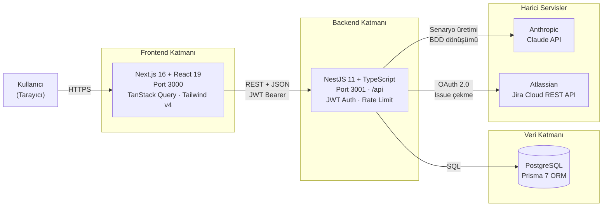
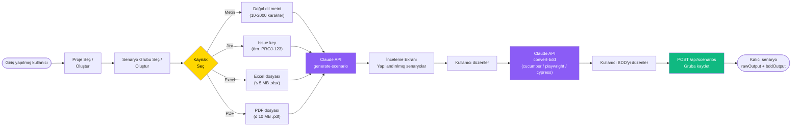
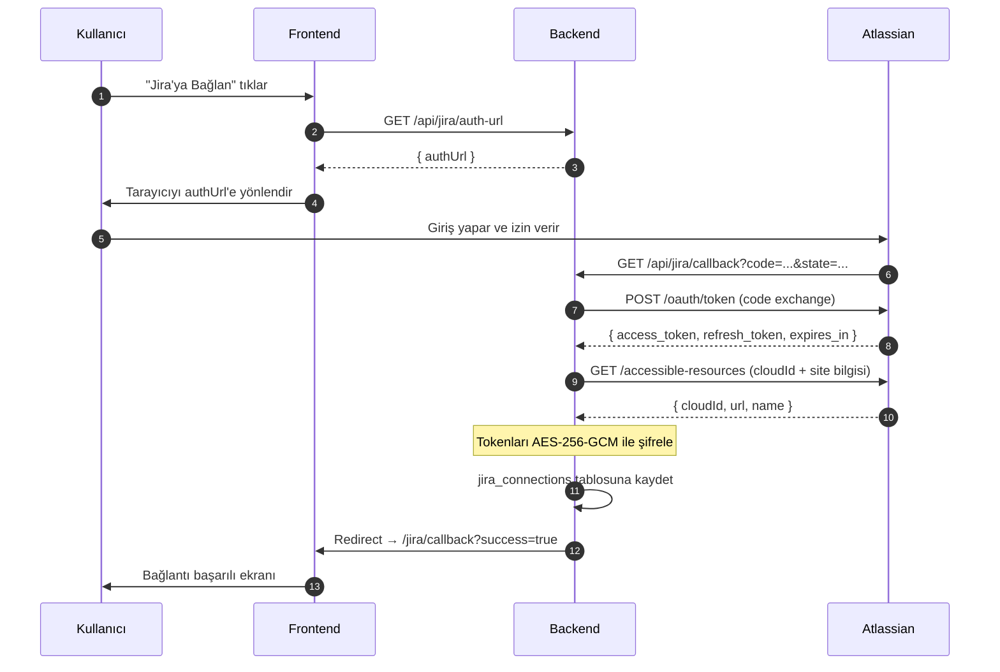

# NexTest — Frontend

**NexTest**, yapay zeka destekli bir QA test senaryosu üretim platformudur. Kullanıcılar proje oluşturur, farklı kaynaklardan (metin, Jira, Excel, PDF) test senaryoları üretir, üretilen senaryoları inceleyip düzenler ve çeşitli formatlarda dışa aktarır.

Bu repo platformun **frontend** uygulamasıdır: Next.js 16 + React 19 ile geliştirilmiştir. Backend ayrı bir serviste (`localhost:3001/api`) çalışır.

> **Dil notu:** Tüm arayüz metinleri, doğrulama mesajları ve kullanıcıya görünen içerik **Türkçe**dir.

---

## İçindekiler

- [Özellikler](#özellikler)
- [Teknoloji Yığını](#teknoloji-yığını)
- [Sistem Mimarisi](#sistem-mimarisi)
- [Başlangıç](#başlangıç)
- [Ortam Değişkenleri](#ortam-değişkenleri)
- [Komutlar](#komutlar)
- [Senaryo Üretim Akışı](#senaryo-üretim-akışı)
- [Jira OAuth Akışı](#jira-oauth-akışı)
- [Proje Yapısı](#proje-yapısı)
- [Mimari Notlar](#mimari-notlar)

---

## Özellikler

- 🗂️ **Proje yönetimi** — proje oluşturma, düzenleme, silme
- 🤖 **AI ile senaryo üretimi** — dört kaynaktan:
  - **Metin** — doğal dil açıklaması (10–2000 karakter)
  - **Jira** — issue key ile bağlama (örn. `PROJ-123`)
  - **Excel** — toplu `.xlsx` yükleme
  - **PDF** — doküman yükleme
- 📝 **İki adımlı akış** — üret → incele/düzenle → kaydet (üretim sırasında otomatik kayıt yok)
- 🥒 **BDD dönüşümü** — senaryoları Cucumber / Playwright / Cypress formatına çevirme
- 📦 **Senaryo grupları** — her kaynak için ayrı grup; grup düzenleme & silme
- 📤 **Dışa aktarma** — çeşitli formatlarda (Excel, Xray vb.) export
- 🔐 **Kimlik doğrulama** — JWT tabanlı login/register, otomatik token yenileme
- 🔗 **Jira entegrasyonu** — OAuth 2.0 ile hesap bağlama

---

## Teknoloji Yığını

| Katman | Teknoloji |
|---|---|
| Framework | Next.js **16.2.6** (App Router) |
| UI | React **19.2.4** |
| Stil | Tailwind CSS **v4** (`@theme inline`) |
| Bileşenler | shadcn/ui (Radix) |
| Sunucu durumu | TanStack React Query |
| Form & doğrulama | React Hook Form + Zod |
| HTTP | Axios (auth interceptor + token refresh) |
| Bildirimler | Sonner (toast) |
| İkonlar | lucide-react |

---

## Sistem Mimarisi



---

## Başlangıç

**Önkoşullar:** Node.js 20+, çalışan NexTest backend (`localhost:3001`).

```bash
# Bağımlılıkları yükle
npm install

# Ortam dosyasını oluştur
cp .env.example .env.local

# Geliştirme sunucusunu başlat
npm run dev
```

Tarayıcıda [http://localhost:3000](http://localhost:3000) adresini aç.

---

## Ortam Değişkenleri

`.env.local` içinde tanımlanır (`.env.example`'dan kopyalayın):

```bash
NEXT_PUBLIC_API_BASE_URL=http://localhost:3001/api
NEXT_PUBLIC_APP_NAME=NexApp
```

---

## Komutlar

```bash
npm run dev      # Geliştirme sunucusu (http://localhost:3000)
npm run build    # Üretim derlemesi
npm run start    # Üretim sunucusu
npm run lint     # ESLint (flat config, v9)
```

> Yapılandırılmış bir test koşucusu yoktur.

---

## Senaryo Üretim Akışı

Üretim **iki adımlıdır**: AI senaryoları üretir (kaydetmez) → kullanıcı inceler/düzenler → kaydedilir.



> AI üretim/dönüşüm uçları uzun sürebildiğinden, bu istekler global 15sn'lik timeout yerine istek bazında **5 dakikalık** timeout kullanır.

---

## Jira OAuth Akışı

Jira hesabı **OAuth 2.0 üç bacaklı (3LO)** akışı ile bağlanır:



---

## Proje Yapısı

```
app/
├── (auth)/                  # Login & register (iki sütunlu layout)
├── (dashboard)/             # Korumalı rotalar
│   ├── projects/            # Proje listesi, detay, üretim, sonuçlar
│   ├── settings/            # Profil & Jira ayarları
│   ├── history/             # Üretim geçmişi
│   └── jira/callback/       # Jira OAuth dönüş ekranı
├── _components/             # Landing page bileşenleri
└── page.tsx                 # Public landing page

components/
├── ui/                      # shadcn/ui primitifleri
├── shared/                  # Tekrar kullanılan app bileşenleri
└── layout/                  # Topbar, sidebar, theme toggle

lib/
├── api/
│   ├── client.ts            # Axios + auth interceptor + token refresh
│   └── endpoints/           # Domain bazlı API fonksiyonları
└── validations/             # Zod şemaları (Türkçe hata mesajları)

types/                       # Backend DTO'larıyla eşleşen TS arayüzleri
proxy.ts                     # Rota koruma middleware'i (access_token cookie)
```

---

## Mimari Notlar

- **Tüm dashboard sayfaları `'use client'`** — korumalı içerik için SSR yoktur.
- **Kimlik doğrulama:** `setTokens()` JWT'yi hem localStorage (client okur) hem cookie'ye (middleware okur) yazar. 401 yanıtları token yenileme + retry kuyruğunu tetikler.
- **Rota koruma:** `proxy.ts` middleware'i `access_token` cookie'sini okur; kimliksiz → `/login`, kimlikli public sayfada → `/projects` yönlendirir (dev modunda kontrol atlanır).
- **Sunucu durumu:** React Query (60sn stale time, 1 retry, focus'ta refetch yok). **Auth durumu:** React Context. **Form durumu:** React Hook Form + Zod. Redux/Zustand kullanılmaz.
- **Tasarım sistemi:** `globals.css` içinde iki katmanlı CSS değişken sistemi — ham palet (`--palette-*`) ve semantik token'lar (`--background`, `--primary`, `--border`...). Bileşenler **yalnızca** semantik token'lara referans verir.
- **API sözleşmesi:** Tüm yanıtlar `ApiResponse<T>` zarfını izler; listeler `PaginatedData<T>` (`{ items, meta }`) kullanır.
